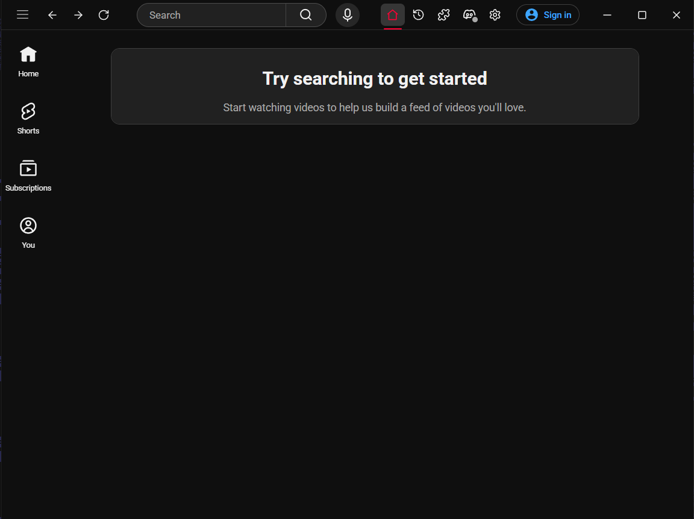

<div align="center">
  
  <h1>Another YouTube Desktop Client</h1>
  <p>A another but lightweigh YouTube desktop client written in Rust (Tauri) and SolidJS.</p>
</div>

<div align="center">
  
</div>

## What’s in the app

| Area | Details |
| --- | --- |
| **Extensions** | Install unpacked Chromium extensions from a folder. The app watches that folder for changes; changing the active set can reload the YouTube WebView. |
| **Watch history** | Stored on this PC, no account needed. |
| **Picture-in-Picture** | Self-explanatory. |
| **Discord** | Rich Presence follows the video playing in YouTube. |
| **Appearance** | Light and dark modes, and others theme support. |

## Requirements

- Windows 10/11 with **WebView2 Evergreen**.
- [Rust](https://rustup.rs/) 1.77+.
- [Node.js](https://nodejs.org/) 20+.
- Visual Studio Build Tools with the "Desktop development with C++" workload.

```powershell
npm install
npm run tauri:dev
```

## How the project is put together

- `src/` — SolidJS interface, title bar, settings, history, and English/Portuguese (Brazil)
  translations.
- `src-tauri/src/` — Rust commands and services for windows, themes, extension profiles, Discord,
  and local storage.
- `injected/` — YouTube page scripts for player state, theme changes, and title-bar integration.
- `src-tauri/capabilities/` — permissions available to each WebView.

The launcher and YouTube live in separate WebViews with separate WebView2 data directories. This
keeps the app pages independent of YouTube and keeps the YouTube profile, including its sign-in,
inside the app.

## Project map

- [Architecture and data flow](docs/architecture.md)
- [Default settings](docs/configuration.md)
- [Sample extension](spikes/test-extension/README.md)

## Extensions

In **Extensions**, select the directory containing an unpacked Chromium extension’s
`manifest.json`. YT Desktop copies it into its app data folder and syncs the enabled extensions
with WebView2. The small example in [`spikes/test-extension`](spikes/test-extension) adds a badge
to YouTube and is there for local development.

## Technologies and upstream projects

| Used here | Upstream project | Role in YT Desktop |
| --- | --- | --- |
| Tauri 2 | [tauri-apps/tauri](https://github.com/tauri-apps/tauri) | Native window, WebViews, system tray, and frontend-to-Rust commands. |
| SolidJS | [solidjs/solid](https://github.com/solidjs/solid) | Reactive app interface. |
| TypeScript | [microsoft/TypeScript](https://github.com/microsoft/TypeScript) | Types for the frontend and Tauri bridge. |
| Vite + Solid plugin | [vitejs/vite](https://github.com/vitejs/vite) · [solidjs/solid-vite-plugin](https://github.com/solidjs/solid-vite-plugin) | Frontend development server and SolidJS compilation. |
| Rust | [rust-lang/rust](https://github.com/rust-lang/rust) | Native application and services. |
| Tokio | [tokio-rs/tokio](https://github.com/tokio-rs/tokio) | Async tasks in the native backend. |
| Serialization | [serde-rs/serde](https://github.com/serde-rs/serde) | Settings and data exchanged with the frontend. |
| SQLx + SQLite | [launchbadge/sqlx](https://github.com/launchbadge/sqlx) · [sqlite/sqlite](https://github.com/sqlite/sqlite) | Local watch-history database and migrations. |
| WebView2 COM bindings | [wravery/webview2-rs](https://github.com/wravery/webview2-rs) | Managing Chromium extensions in the WebView2 profile. |
| Window materials | [tauri-apps/window-vibrancy](https://github.com/tauri-apps/window-vibrancy) | Mica and Acrylic window effects. |
| Folder picker | [tauri-apps/plugins-workspace](https://github.com/tauri-apps/plugins-workspace) | Tauri dialog plugin used to select extension folders. |
| Discord Rich Presence crate | [vionya/discord-rich-presence](https://github.com/vionya/discord-rich-presence) | Discord IPC connection. |

The Discord presence design also took [YouTubeDiscordPresence](https://github.com/XFG16/YouTubeDiscordPresence)
as a reference. It is a separate project; YT Desktop’s implementation is maintained here.

## Notice

The app loads the official YouTube website in a webview. It does not remove ads
or download videos. Use is subject to YouTube's Terms of Service.

## License

This project is licensed under the GNU GPL v3.0. See the [LICENSE](LICENSE) file.
