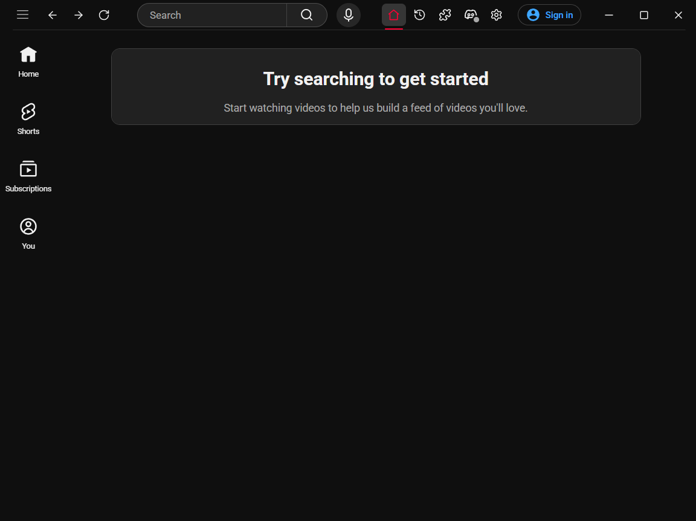

<div align="center">
  
  <h1>YouTube Client</h1>
  <p>A lightweight, native-feeling YouTube desktop client built with Rust (Tauri v2) and SolidJS.</p>

  <p>
    <a href="https://github.com/kazwtto/youtube-client/releases"></a>
    <a href="https://github.com/kazwtto/youtube-client/blob/main/LICENSE"></a>
    <a href="https://github.com/sponsors/kazwtto"></a>
    
  </p>
</div>

<div align="center">
  
</div>

## Features

| Area | Details |
| --- | --- |
| **Multi-tab & Independent Sessions** | Switch between Action Menu (`Ctrl+Tab`), Bottom bar, Floating dock, Fixed resizable sidebar, or Auto-hide sidebar. Open isolated tabs with separate Google accounts, cookies, and history, plus automatic tab sleeping. |
| **Extensions** | Install unpacked Chromium extensions from a folder or `.zip`. The app watches that folder for changes and syncs enabled extensions with WebView2. |
| **Watch History** | Local SQLite watch history with search, date filters, resume playback, and session filtering — no account required. |
| **Picture-in-Picture** | Native and custom Picture-in-Picture modes with minimize/blur triggers. |
| **Discord Rich Presence** | Publishes active or playing video details, timestamps, and buttons to Discord. |
| **Appearance & Themes** | Light/dark modes, Windows Mica/Acrylic/Solid backdrops, customizable corner radius, and motion controls. |
| **GitHub Update Checker** | Built-in update checker in **Settings → Updates** with automatic checks and pre-release support. |

## Requirements

- Windows 10/11 with **WebView2 Evergreen**.
- [Rust](https://rustup.rs/) 1.77+.
- [Node.js](https://nodejs.org/) 20+.
- Visual Studio Build Tools with the **Desktop development with C++** workload.

```powershell
npm install
npm run tauri:dev
```

To build a release bundle:

```powershell
npm run tauri:build
```

## Project Structure

- `src/` — SolidJS interface, title bar, tab layouts, settings, history, and English/Portuguese (Brazil) translations.
- `src-tauri/src/` — Rust backend for windows, multi-tab WebViews, themes, extensions, Discord RPC, local SQLite storage, and GitHub release checks.
- `injected/` — Scripts injected into YouTube for playback tracking, theme sync, context menu, and title-bar integration.
- `src-tauri/capabilities/` — Tauri v2 ACL permissions for each WebView.

The launcher and YouTube run in separate WebViews with isolated WebView2 user data directories, keeping app pages fast and independent from YouTube sessions.

## Documentation

- [Architecture and data flow](docs/architecture.md)
- [Default settings](docs/configuration.md)
- [Contributing guide](CONTRIBUTING.md)
- [Sample extension](spikes/test-extension/README.md)

## Technologies and Upstream Projects

| Used here | Upstream project | Role |
| --- | --- | --- |
| Tauri 2 | [tauri-apps/tauri](https://github.com/tauri-apps/tauri) | Native window, WebViews, system tray, and IPC commands. |
| SolidJS | [solidjs/solid](https://github.com/solidjs/solid) | Reactive app interface. |
| TypeScript | [microsoft/TypeScript](https://github.com/microsoft/TypeScript) | Frontend types and Tauri bridge. |
| Motion | [motiondivision/motion](https://github.com/motiondivision/motion) | Hardware-accelerated UI animations. |
| Vite + Solid plugin | [vitejs/vite](https://github.com/vitejs/vite) · [solidjs/solid-vite-plugin](https://github.com/solidjs/solid-vite-plugin) | Frontend bundler and dev server. |
| Rust & Tokio | [rust-lang/rust](https://github.com/rust-lang/rust) · [tokio-rs/tokio](https://github.com/tokio-rs/tokio) | Native backend and async runtime. |
| SQLx + SQLite | [launchbadge/sqlx](https://github.com/launchbadge/sqlx) · [sqlite/sqlite](https://github.com/sqlite/sqlite) | Local watch-history database and migrations. |
| WebView2 COM bindings | [wravery/webview2-rs](https://github.com/wravery/webview2-rs) | Chromium extension management in WebView2. |
| Window materials | [tauri-apps/window-vibrancy](https://github.com/tauri-apps/window-vibrancy) | Windows Mica and Acrylic effects. |
| Discord Rich Presence | [vionya/discord-rich-presence](https://github.com/vionya/discord-rich-presence) | Discord IPC integration. |

## Support the Project

Enjoying YouTube Client? You can support development via [GitHub Sponsors](https://github.com/sponsors/kazwtto), starring the repository, or reporting bugs and suggestions through [Issues](https://github.com/kazwtto/youtube-client/issues).

## Notice

The app loads the official YouTube website inside a WebView. It does not remove ads or download videos. Use is subject to YouTube's Terms of Service.

## License

This project is licensed under the GNU GPL v3.0. See [LICENSE](LICENSE) for details.
